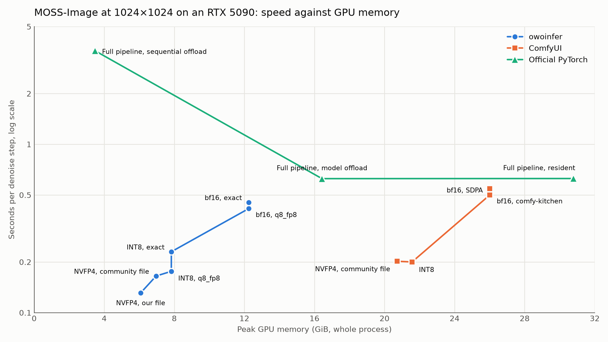
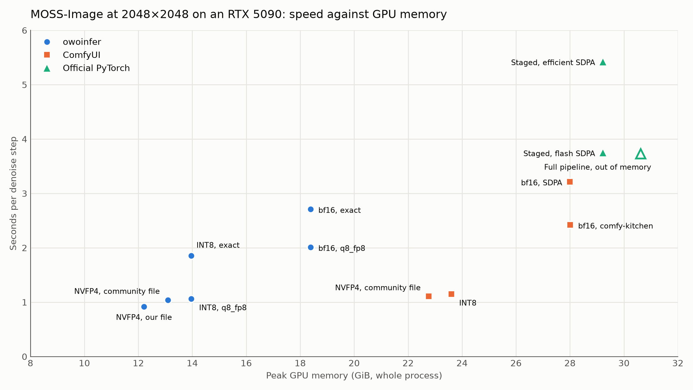
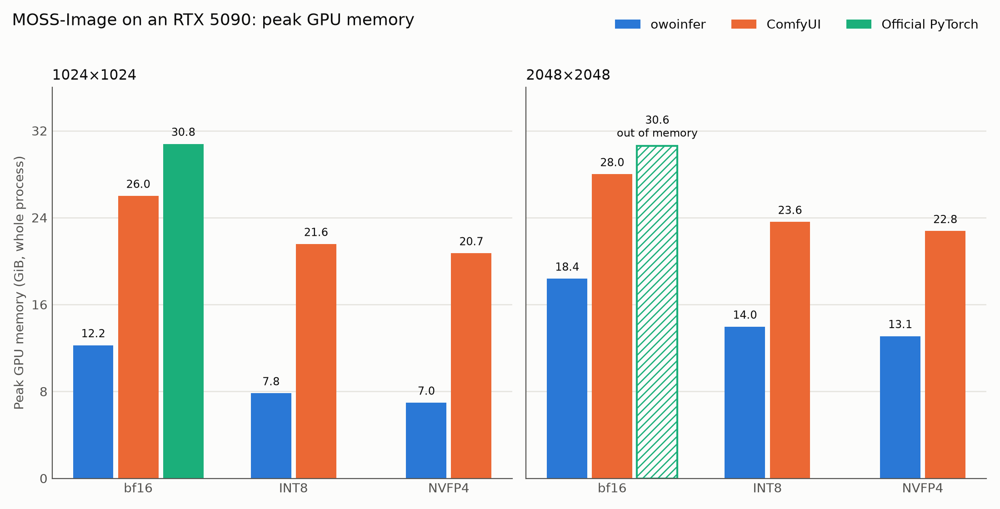
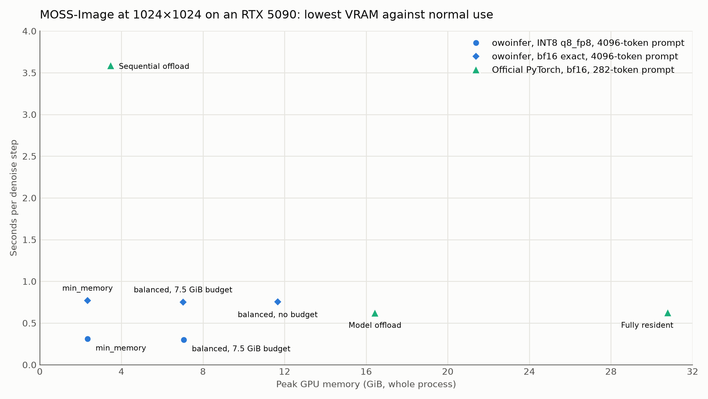

# MossInfer

A native C++/CUDA inference engine for the MOSS-Image text-to-image model (5B DiT, Qwen3.5 text encoder, FLUX.2 VAE), with no PyTorch or Python at run time. It plans memory against the GPU it finds and streams the model when it does not fit.

Models: MOSS-Image Base and SFT, in the official folders and common community formats; other models are refused ([supported models](#supported-models)).

Version 2.1.2. Supported: Linux x86-64 and Windows x64 (MSVC), each with a CUDA 12 and a CUDA 13 build, as a full package and a `-system-cuda` package. Turing (compute capability 7.5, e.g. RTX 2080) is supported by builds configured with `-DMOSSINFER_SM75=ON` (the `windows-msvc-cuda13-sm75` preset packages it): fp16 tensor-core GEMMs replace the bf16 ones, INT8 and INT4 ConvRot files run the INT8 GEMMs, the exact attention and the VAE run sm_75 kernels, all three quality tiers work, and an unset attention resolves to `exact`. See [docs/sm75.md](docs/sm75.md) for what runs, the measured speed on an RTX 2080 Ti and the remaining gaps. Volta (Tesla V100, sm_70) is supported by the CUDA 12 `linux-cuda12-sm70` preset; see [docs/sm70.md](docs/sm70.md) for its kernels, validation and performance. Other GPUs (AMD, Intel, older NVIDIA) can run txt2img at the reference tier through `moss-infer-vulkan`, a separate and slower Vulkan program in its own package ([docs/vulkan.md](docs/vulkan.md)). The full support matrix is in [docs/integration.md](docs/integration.md#support-status).

The caller picks the quality tier: `reference` (bf16, exact), `high` (the loaded DiT's GEMMs with 8-bit attention) or `turbo` (a 4-bit DiT). An INT8 DiT with `high` is the everyday choice: 2.5 times the bf16 speed on an RTX 5090, in 40 % less VRAM ([performance](docs/integration.md#performance)). Upgrading from 1.x: [migration](docs/integration.md#migrating-from-1x).

```sh
moss-infer generate --model MOSS-Image/sft --dit moss_image_sft_int8_convrot.safetensors --tier high \
  --prompt "a red apple on a wooden table" -o apple.png
```

Speed against GPU memory on an RTX 5090 at 50 steps, where down and to the left is better. owoinfer is this engine. Memory is the whole-process peak, which for ComfyUI includes models it keeps cached while memory is free. The official pipeline runs use the base model and the other runs use SFT, and samplers differ between implementations. At 2048×2048 the official pipeline runs out of memory in the VAE decode.





The same peaks on their own. The official PyTorch runs use bf16 only, and ComfyUI's peak is not a minimum requirement.



Lowest VRAM against normal use at 1024×1024. `min_memory` streams the DiT and costs about 3 % per step here. The owoinfer runs use a 4096-token prompt and the official pipeline runs use a 282-token prompt.



- [docs/integration.md](docs/integration.md): building the engine into an application. Start here.
- [docs/sm70.md](docs/sm70.md): Volta (Tesla V100) support: CUDA 12 build, exact INT8 accumulation, validation and performance.
- [docs/sm75.md](docs/sm75.md): Turing (compute capability 7.5) support: build and package, what runs, measured speed on an RTX 2080 Ti, limitations.
- [docs/vulkan.md](docs/vulkan.md): `moss-infer-vulkan`, the Vulkan fallback for GPUs the CUDA engine does not support.
- [docs/c-api.md](docs/c-api.md): the C library, `include/mossinfer/mossinfer.h`.
- [docs/server-protocol.md](docs/server-protocol.md): `moss-server`, the JSON-lines sidecar process.

Build (CUDA 12.x or 13.x, CMake ≥ 3.28, Ninja; Linux: GCC ≥ 12 and GoogleTest; Windows: a Visual Studio 2022 x64 developer prompt):

```sh
cmake --preset linux-cuda13 && cmake --build --preset linux-cuda13
CUDA_VISIBLE_DEVICES="" ctest --preset linux-cuda13 -L '^cpu$'
```

The other presets are `linux-cuda12`, `linux-cuda12-sm70`, `windows-msvc-cuda13`, `windows-msvc-cuda13-sm75` and `windows-msvc-cuda12` ([docs/integration.md](docs/integration.md#getting-the-binaries)). The `windows-msvc-cuda13-sm75` preset builds a full CUDA 13 package with Turing (sm_75) support and names it with the `-sm75` suffix; the `linux-cuda12-sm70` preset adds Volta with a `-sm70` suffix. The standard presets remain Ampere-or-newer.

## Supported models

The engine runs one architecture, MOSS-Image: the 5B DiT, the Qwen3.5-9B text encoder and the FLUX.2 VAE. It identifies a model from its configs and safetensors headers, and refuses anything else with a message naming what it found.

| Component | What loads |
|---|---|
| Model folder | `OpenMOSS-Team/MOSS-Image-Base` and `OpenMOSS-Team/MOSS-Image-SFT` (or the ModelScope copies), and fine-tunes with the same architecture |
| DiT file | INT8 ConvRot (tier `high`), INT4 ConvRot (tier `turbo`), NVFP4 (tier `turbo`, RTX 50 only); GGUF Q8_0, Q6_K, Q5_K, Q4_K, Q4_0, BF16 and F16, converted once on first load |
| Text encoder file | INT8 ConvRot, W4A8 GPTQ |
| VAE file | FLUX.2 VAE, full or small |
| LoRAs and adapters | PEFT, kohya and LyCORIS LoHa LoRAs, distill LoRAs and bundles, the colour and depth control adapter. Runtime LoRAs and control adapters need Ampere or newer |

Not supported: other OpenMOSS models (MOSS-VL, MOVA, MOSS-TTS and others), text encoders of other sizes, torchao and FP8 weights, and MLX, SDNQ, DFloat11 and PyTorch `.bin` / `.pt` files. [docs/integration.md](docs/integration.md#supported-models) lists the files and revisions, how each one loads, and what the engine says when it refuses one.

## Contributors

- [xycld](https://github.com/xycld): the engine
- [CloverIris](https://github.com/CloverIris): Turing (sm_75) support
- [samyycX](https://github.com/samyycX): Volta (sm_70) support

## License

Licensed under Apache-2.0 (`LICENSE`, `NOTICE`, `THIRD_PARTY_NOTICES.md`).
